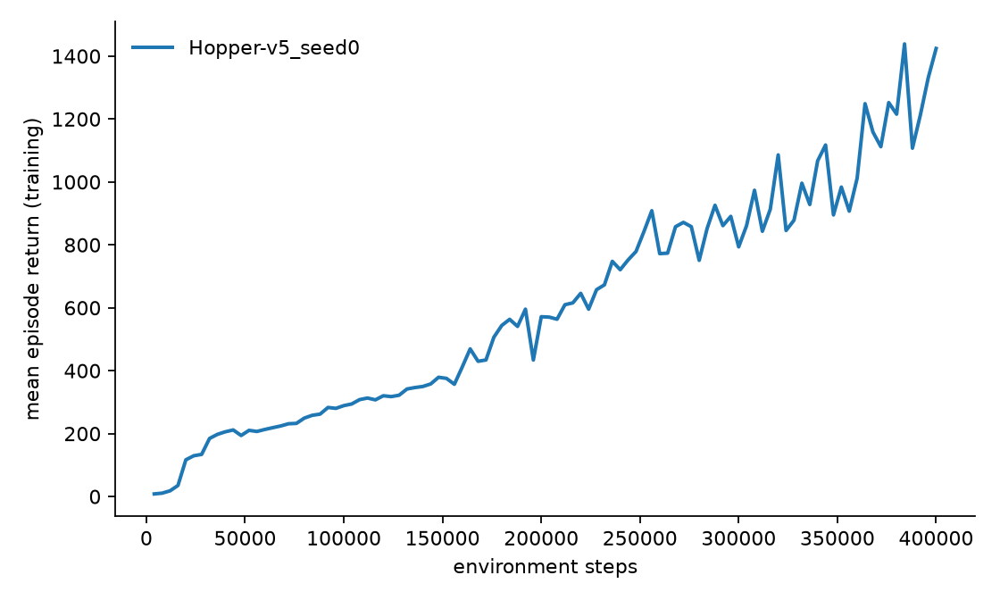

# mujoco-locomotion-lab

PPO for MuJoCo continuous control, written from scratch in PyTorch and evaluated the way I wish more RL repos were. Training reward curves flatter the run that produced them, so this repo reports something stricter. Every headline number comes from the deterministic mean policy, on 100 fresh episodes, with evaluation seeds that never overlap the training seed.

Most of the algorithm fits in two small files. `locolab/ppo.py` has the Gaussian actor, the value critic, the clipped surrogate objective and a KL early stop. `locolab/buffer.py` has the rollout storage and generalized advantage estimation. There is no framework underneath, because the point is to show the algorithm, and the tests pin the math down to hand computed values.

## Results

Both runs use a single stated seed, 200k steps for the pendulum and 400k for Hopper, on CPU.

| env | held out mean return | std | min | max | episodes |
|-|-|-|-|-|-|
| InvertedPendulum-v5 | 1000.0 | 0.0 | 1000.0 | 1000.0 | 100 |
| Hopper-v5 | 3157.6 | 136.9 | 2703.9 | 3350.5 | 100 |

InvertedPendulum reaches the environment ceiling, 1000 out of 1000 on every one of the 100 evaluation episodes. Hopper is the more interesting row. Its final training epoch averaged 1424 per episode, and the held out deterministic policy scores 3157.6, which looks backwards until you see the mechanism. Training returns average over episodes that end early when the sampled exploration noise tips the hopper over, so the noisy learner drags the number down while the mean policy it was learning runs most episodes to the full 1000 steps. That gap is exactly why this repo refuses to report training curves as results.

The trained policies behind the table are committed under `results/checkpoints/`, about 45 KB each, so the table reproduces from a clean clone without retraining.

```bash
python -m locolab.evaluate results/checkpoints/Hopper-v5_seed0 --episodes 100
```

Raw numbers live in `results/*.json` and the learning curves in `results/*.png`, all regenerated by the commands below.



## Why the evaluation is set up this way

An RL agent is trained and tuned on one stream of episodes, so returns measured on that same stream are closer to a training score than a test score. The evaluation script starts every episode from seed 10000 upward while training uses seeds below 100, and it acts with the policy mean instead of sampling. That gives a held out measurement of the policy that would actually be deployed, and the report includes the spread, because a mean without a minimum hides the crashes.

## Run it

```bash
python -m venv .venv && source .venv/bin/activate
pip install -r requirements.txt

python -m locolab.train --env InvertedPendulum-v5 --epochs 50
python -m locolab.evaluate runs/InvertedPendulum-v5_seed0 --episodes 100
python -m locolab.plots runs/InvertedPendulum-v5_seed0 --out results/curve.png
```

`pytest tests` runs the unit and smoke tests. The GAE test checks the advantage recursion against values computed by hand, the PPO test checks that an update moves the policy mean toward positively rewarded actions, and the smoke test trains, saves, reloads and evaluates a real policy in under a minute. CI runs the same suite headless with rendering disabled.

## What is deliberately not here

No replay buffer and no off policy machinery, because PPO is on policy and mixing the two breeds bugs that no test catches. No reward shaping and no environment tweaks, so the numbers compare directly against published PPO results on the standard v5 tasks. One seed per reported run, stated openly, because averaging three cherry picked seeds is worse than showing one honest one.

The boundary condition worth naming is that this PPO is tuned for the smaller MuJoCo tasks. On high dimensional bodies like Humanoid it would need observation normalization and a larger network before the same recipe holds.

## License

MIT, copyright 2026 Laela Zorana.
